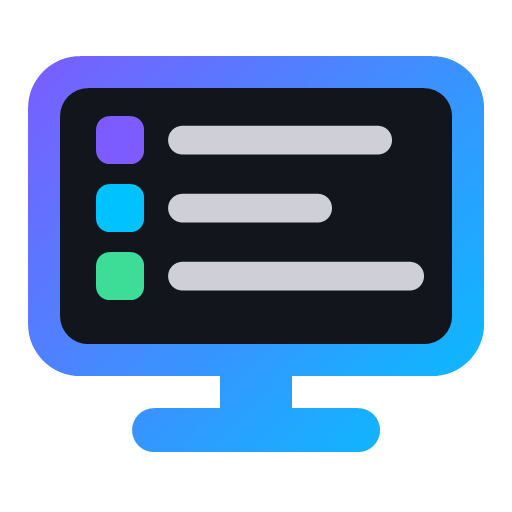

# Bastion

**🌐 Language:** **English** | [Português](https://github.com/kauavfialho/bastion/blob/main/README.pt-BR.md)

A Windows app to take care of your computer: live CPU, RAM, GPU and ping, PC health with the likely cause of crashes, cleanup, tweaks for games, peripheral lights, app installer and a step-by-step guide to format your PC and set up the BIOS. No login and no server: nothing about your computer leaves it.

The goal is to help anyone, from a child to a grandparent, keep their computer fast and healthy, for free. The app was generated by artificial intelligence, based on an idea by Kauã Fialho.

> Choose Portuguese, English or Spanish with the selector at the top of the app.

## Download

Click the file for your computer and the download starts right away. The link always gets the latest version, and the sizes are approximate.

### Installer (recommended)

| Computer | Download | Size |
|---|---|---|
| 64-bit Windows (Intel or AMD) | [⬇️ Download for Windows (.exe)](https://github.com/kauavfialho/bastion/releases/latest/download/Bastion-win-x64.exe) | 58 MB |
| Windows on ARM (Snapdragon) | [⬇️ Download for Windows ARM (.exe)](https://github.com/kauavfialho/bastion/releases/latest/download/Bastion-win-arm64.exe) | 53 MB |

### Portable (no installation needed)

| Computer | Download | Size |
|---|---|---|
| 64-bit Windows (Intel or AMD) | [⬇️ Download portable for Windows (.exe)](https://github.com/kauavfialho/bastion/releases/latest/download/Bastion-win-x64-portable.exe) | 64 MB |

Works on Windows 10 and 11. There is no version for 32-bit Windows. Mac and Linux versions are planned; most features use tools that only exist on Windows, so they will be a different, smaller app.

See [all versions](https://github.com/kauavfialho/bastion/releases).

The app has no paid certificate, so Windows shows a warning the first time: on the blue SmartScreen window, click "More info" and then "Run anyway".

You can also install and update Bastion from the [Vitall Launcher](https://github.com/kauavfialho/vitall-launcher).

## What it does

- **Home:** live CPU, RAM, GPU (usage, temperature, watts) and ping, with mini charts, and a button to free RAM.
- **PC health:** antivirus, SSD/HD health, RAM (and whether XMP is off) and every blue screen of the last 90 days with its likely cause, in plain language.
- **Cleanup:** temporary files, browser and shader caches, Windows Update leftovers, Recycle Bin and the biggest folders on the system drive.
- **Organizer:** new images go to Pictures and videos to Videos, automatically, from a tray icon.
- **Startup:** choose what opens with Windows, using the same switch as Task Manager.
- **Games:** power plan, Game Mode, Game Bar recording, mouse acceleration, GPU scheduling and a connection test (ping, jitter and packet loss).
- **Debloat:** restore point, removal of preinstalled apps and ads, telemetry and Bing turned off. Everything can be undone.
- **Install apps:** 26 game launchers and ArtCraft apps through winget, and everyday programs through Ninite, in one click and without ads.
- **Format PC:** pre- and post-format checklists that save your progress, BIOS settings with what is already right on your PC, and a BIOS guide image for your phone.
- **My PC:** every part and peripheral Windows can detect, including dual channel and controllers.
- **Peripherals:** the lights of RAM, keyboards, mice and motherboards from many brands in one place (through OpenRGB), and control over vendor apps.
- **Tests:** CPU, RAM (with error checking) and disk stress tests, stopped automatically if the GPU gets too hot.
- **Drivers:** devices with problems, main drivers and where to update each one.
- **Appearance:** accent colors, backgrounds and an optional binary rain on the sidebar.

Some features need administrator rights. The app opens without them and asks only when needed, coming back to the same screen.

## License

MIT. You can use, adapt and distribute it, as long as you keep the license notice. The app comes with no warranty: changes to the system, BIOS and overclock are your own choice.

## Development

Requires the [.NET 8 SDK](https://dotnet.microsoft.com/download/dotnet/8.0) on Windows.

```bash
dotnet build
```

```bash
dotnet publish -c Release -o dist
```

To build the installers, the portable version and `latest.yml` locally (needs [NSIS](https://nsis.sourceforge.io)):

```bash
./instalador/gerar.ps1
```

To create a new version, update `Version` in `Bastion.csproj` and publish a `v*` tag. GitHub Actions builds the installers and creates the Release. See [CONTRIBUTING.md](CONTRIBUTING.md) to work on the code.
