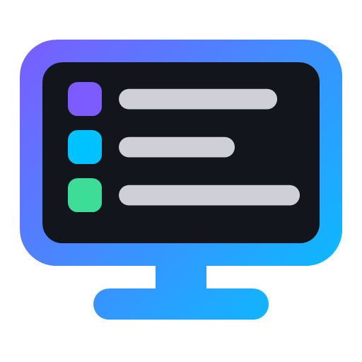

# Bastion

**🌐 Idioma:** [English](https://github.com/kauavfialho/bastion#readme) | **Português**

App de Windows para cuidar do computador: CPU, RAM, placa de vídeo e ping ao vivo, saúde do PC com a causa provável dos travamentos, limpeza, ajustes para jogos, luzes dos periféricos, instalador de programas e um passo a passo para formatar o PC e configurar a BIOS. Sem login e sem servidor: nada sobre o seu computador sai dele.

A ideia é ajudar qualquer pessoa, da criança ao avô, a deixar o computador rápido e saudável, de graça. O app foi gerado por inteligência artificial, a partir de uma ideia de Kauã Fialho.

O app está disponível em português, inglês e espanhol: é só escolher no seletor do topo.

## Download

Clique no arquivo do seu computador e o download começa na hora. O link sempre pega a versão mais nova, e os tamanhos são aproximados.

### Instalador (recomendado)

| Computador | Download | Tamanho |
|---|---|---|
| Windows 64 bits (Intel ou AMD) | [⬇️ Baixar para Windows (.exe)](https://github.com/kauavfialho/bastion/releases/latest/download/Bastion-win-x64.exe) | 58 MB |
| Windows ARM (Snapdragon) | [⬇️ Baixar para Windows ARM (.exe)](https://github.com/kauavfialho/bastion/releases/latest/download/Bastion-win-arm64.exe) | 53 MB |

### Portátil (não precisa instalar)

| Computador | Download | Tamanho |
|---|---|---|
| Windows 64 bits (Intel ou AMD) | [⬇️ Baixar portátil para Windows (.exe)](https://github.com/kauavfialho/bastion/releases/latest/download/Bastion-win-x64-portable.exe) | 64 MB |

Funciona no Windows 10 e 11. Não há versão para Windows 32 bits. As versões para Mac e Linux estão nos planos; como a maior parte das funções usa ferramentas que só existem no Windows, elas serão um app diferente e menor.

Veja [todas as versões](https://github.com/kauavfialho/bastion/releases).

O app não tem certificado pago, então o Windows mostra um aviso na primeira vez: na janela azul do SmartScreen, clique em "Mais informações" e depois em "Executar assim mesmo".

Você também pode instalar e atualizar o Bastion pelo [Vitall Launcher](https://github.com/kauavfialho/vitall-launcher).

## O que ele faz

- **Início:** CPU, RAM, placa de vídeo (uso, temperatura e watts) e ping ao vivo, com mini-gráficos, e um botão para liberar RAM.
- **Saúde do PC:** antivírus, saúde do SSD/HD, RAM (e se o XMP está desligado) e cada tela azul dos últimos 90 dias com a causa provável, em português simples.
- **Limpeza:** arquivos temporários, caches de navegador e de shaders, sobras do Windows Update, Lixeira e as maiores pastas do disco do sistema.
- **Organizador:** imagens novas vão para Imagens e vídeos para Vídeos, sozinhos, com um ícone perto do relógio.
- **Inicialização:** escolha o que abre com o Windows, com o mesmo controle do Gerenciador de Tarefas.
- **Jogos:** plano de energia, Modo de Jogo, gravação do Game Bar, aceleração do mouse, agendamento de GPU e teste de conexão (ping, variação e perda de pacotes).
- **Debloat:** ponto de restauração, remoção de apps de fábrica e anúncios, telemetria e Bing desligados. Tudo pode ser desfeito.
- **Instalar apps:** 26 launchers de jogos e apps ArtCraft pelo winget, e programas do dia a dia pelo Ninite, de uma vez e sem propaganda.
- **Formatar PC:** planos pré e pós-formatação que guardam o seu progresso, ajustes da BIOS com o que já está certo no seu PC e uma imagem com o guia da BIOS para o celular.
- **Meu PC:** todas as peças e periféricos que o Windows consegue detectar, inclusive dual channel e controladoras.
- **Periféricos:** as luzes de RAM, teclados, mouses e placas-mãe de várias marcas num lugar só (pelo OpenRGB), e controle dos apps de fabricante.
- **Testes:** estresse de CPU, RAM (com verificação de erros) e disco, que param sozinhos se a placa de vídeo esquentar demais.
- **Drivers:** dispositivos com problema, os drivers principais e onde atualizar cada um.
- **Aparência:** cores de destaque, fundos e uma chuva binária opcional na barra lateral.

Algumas funções precisam de administrador. O app abre sem essa permissão e só pede quando precisa, voltando para a mesma tela.

## Licença

MIT. Você pode usar, adaptar e distribuir, desde que mantenha o aviso da licença. O app vem sem garantia: mudanças no sistema, na BIOS e overclock são escolha sua.

## Desenvolvimento

Precisa do [.NET 8 SDK](https://dotnet.microsoft.com/download/dotnet/8.0) no Windows.

```bash
dotnet build
```

```bash
dotnet publish -c Release -o dist
```

Para gerar os instaladores, a versão portátil e o `latest.yml` no seu PC (precisa do [NSIS](https://nsis.sourceforge.io)):

```bash
./instalador/gerar.ps1
```

Para criar uma versão nova, atualize `Version` no `Bastion.csproj` e publique uma tag `v*`. O GitHub Actions gera os instaladores e cria a Release. Veja o [CONTRIBUTING.md](CONTRIBUTING.md) para mexer no código.
